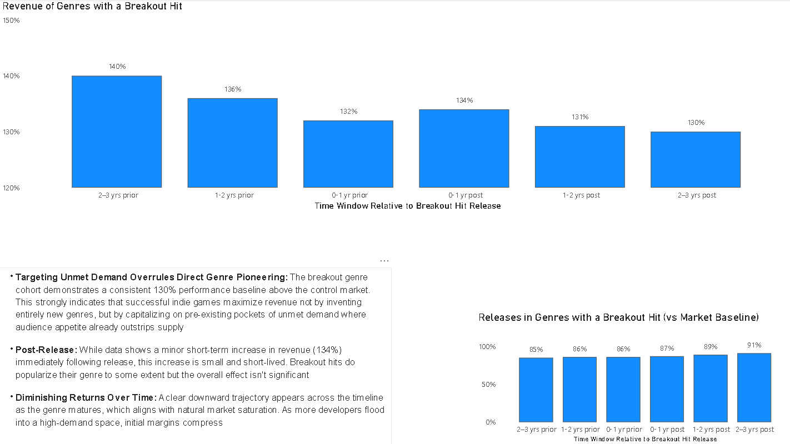
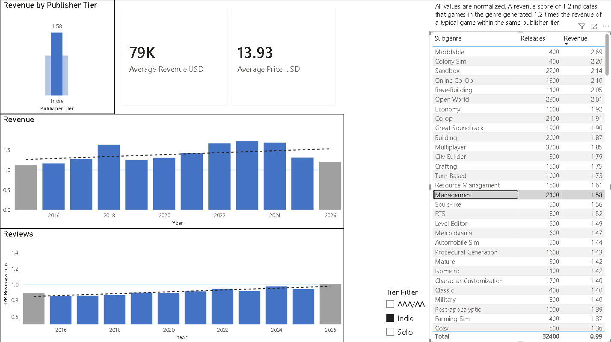
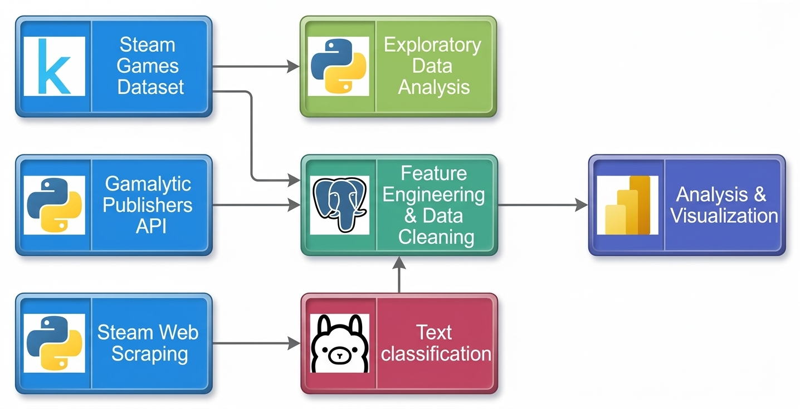

<h1 align="center">Which Steam Subgenres Make the Most Money for Indie Studios?</h1>

An Analysis of 150k Steam games to find where small studios can compete.                                                            
**Key finding**: system-driven genres (Base Building, Resource Management, Deckbuilding) consistently outperform, because they reward mechanical depth over production budget.
                                                                                                                                                                                           
**[Interactive Power BI Dashboard Download ↓](https://github.com/Lezaleas/Steam-Subgenres/raw/refs/heads/main/Pictures/steam.pbix)**

# 1. Trend Drivers

Analyzing subgenre dynamics before, during, and after the launch of a major breakout title reveals the following:
- Rather than inventing entirely new categories, breakout hits succeed by refining mechanics within underserved markets.
- Studios should mitigate financial risk by directing R&D resources toward established gameplay loops in high-demand, low-competition niches rather than burning capital on unproven concepts.
- To guide future development and market positioning, we must examine which genres yield the strongest financial performance.

# 2. Genre Viability

| Developer Tier | Strategic Focus & Characteristics | High-Performing Tags |
| :--- | :--- | :--- |
| **AAA / AA Publishers** | Focuses on immersive experiences requiring substantial investment in realistic graphics, detailed environments, and large amounts of handcrafted content. | *First-Person, Atmospheric, Exploration* |
| **Solo Developers** | Leverages flexibility to explore riskier ideas, target niche audiences or draw on specialized knowledge. | *LGBTQ+, Dating Sim, Memes, Story Rich* |
| **Indie Studios** | Focuses on systemic depth, replayability, and complex mechanical loops rather than massive open-world production scales. | *Base Building, Economy, Resource Management, Deckbuilding,* |

Indie studios occupy an interesting middle ground: they generally lack the resources to create enormous worlds filled with handcrafted content, but have the capacity to develop highly polished strategic and mechanical systems for players to engage with. This makes games built around complex mechanics or system-driven engagement particularly well-suited to their strengths.

The highest-revenue tags tend to belong to a category colloquially known as Crafty Buildy Simulation Strategy games. Other consistently strong categories include games with deep and engaging mechanics, such as RTS, Souls-like, and Survival.

<b>What are "Crafty Buildy Simulation Strategy" games? (Click to expand)</b>

These are games centered around managing resources and developing complex systems through strategic decision-making. They typically give players considerable freedom to interact with a simulation, experiment with different approaches, and gradually build increasingly sophisticated systems. Much of their appeal comes from the satisfaction of planning and optimization.

The term was popularized by the following article: [What Are Crafty Buildy Strategy Simulation Games?](https://howtomarketagame.com/2024/12/27/what-are-crafty-buildy-strategy-simulation-games/)

# 3. AI Usage

Work in progress. The study will investigate if there's a correlation between disclosed use of AI and sales.

# 4. Methodology

### [Technical Methodology Report →](Methodology.md)

